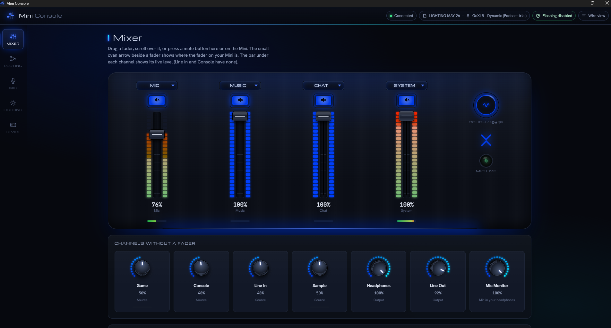
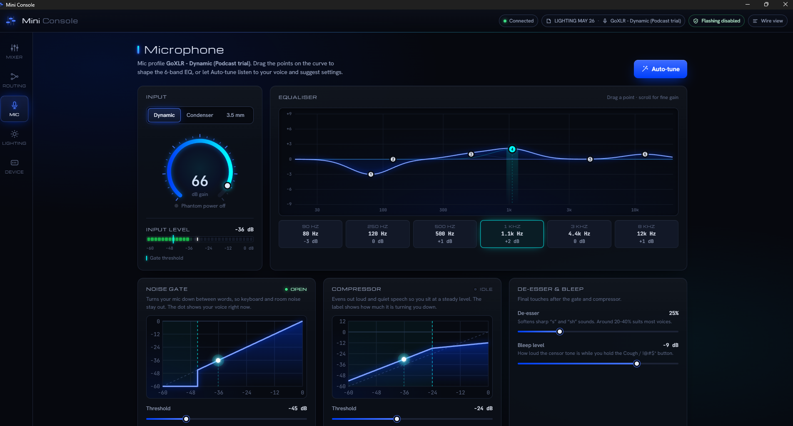

# Mini Console

**A small, fast control app for the TC-Helicon GoXLR Mini, with a mic auto-tune that listens to your
voice and sets up your mic for you.**

The GoXLR Mini is still a great little mixer. Mini Console gives it an app to match: one 2.5 MB
program that opens in a moment, sits quietly in the background, and puts every control the Mini has
on a single screen designed to look and feel like the hardware. It reads and writes the same profile
files you already have, so you can switch over without setting anything up again.



> Mini Console is an independent project. It is not made, endorsed or supported by TC-Helicon or
> Music Tribe. "GoXLR" and "TC-Helicon" are trademarks of their owners and are used here only to say
> which device this app works with.

## Why you might like it

- **Your mic, tuned in under a minute.** Read a few lines, and Mini Console works out your gain, EQ,
  noise gate, compressor and de-esser. It then lets you hear the difference before you keep anything.
- **Everything in one place.** Mixer, routing, mic, lighting and profiles, with no menus to dig through.
- **It stays in step with the hardware.** Move a fader or press a button on the Mini and the screen
  follows instantly. Change something on screen and the Mini follows too.
- **Your profiles are safe.** It uses your existing `.goxlr` and `.goxlrMicProfile` files, changes
  only the values you touched, and keeps a backup every time it saves.
- **Light and private.** No account, no sign-in, no telemetry. It never goes online, and even its
  fonts are built in.
- **It can't brick your Mini.** Firmware updates aren't something the app can do at all
  ([more below](#it-never-touches-your-firmware)).

## A quick tour

### Mixer
The four faders and their mute buttons, laid out like the Mini itself. Drag a fader, scroll over it
for fine control, or click a mute. Each channel has a live level meter. A small marker next to each
on-screen fader shows where the physical fader on your Mini actually is. Want Music on a different
fader? Pick a new channel for it, and if that channel was already on another fader, the two simply
swap. The Cough / bleep button sits alongside, with a lamp that shows at a glance whether your
mic is live or muted. The channels that don't have a fader of their own get volume knobs below.

**Submix** gives every source a second, independent volume, so two places can hear a different
balance. The classic use: your stream hears the music quietly, while your headphones keep it loud.

### Routing
A clear grid of which sources reach which outputs. Click a pad to connect or disconnect it. Lit pads
pulse with the sound passing through them, so you can see at a glance what's actually live. Routes
that are held off by a mute are marked as such, so a silent output is never a mystery.

### Microphone
Choose dynamic, condenser (with phantom power) or 3.5 mm, and set your gain against a live input
meter. Shape the 6-band EQ by dragging points on the curve. The noise gate and compressor are drawn
as graphs that react to your voice as you speak, so you can see exactly when the gate opens and how
hard the compressor is working. The de-esser and bleep level finish things off.



### Mic auto-tune
Click **Auto-tune** and follow along for about a minute. It records your voice through the GoXLR's
own driver, capturing your raw mic and the processed result at the same time. It measures:

- how loud you are, and how much headroom you have
- the background noise in your room
- your tone, compared with a balanced podcast voice
- harsh "s" sounds and popped "p"s

You then get a short list of suggested changes, each with a plain-English reason. Try them, read a
quick check passage, and listen to before and after side by side, including a volume-matched version
so you're comparing tone rather than loudness. If it's close but not quite there, it can refine and
check again. It also suggests a voice-activity sensitivity setting for Discord.

When you're happy, **Keep** saves the result as a new mic profile. Your existing profile is never
overwritten, and **Undo** puts everything back exactly as it was.

### Lighting
Click any part of the drawn Mini to change its colour, and the real one changes as you pick. You
can also set the fader display styles and the animation, with a preview on screen.

### Device and profiles
Switch between your profiles and mic profiles with a click. Your current changes are saved first,
and everything is saved again when you close the app. From here you can also turn on
**Start with Windows** (the app opens minimised when you sign in) and check your Mini's firmware
version. There's also an optional live view of every message the app sends to the Mini, for the
curious.

## It never touches your firmware
Mini Console cannot update, erase or reprogram your Mini, and that's a deliberate design choice, not
a missing feature. Every message to the device passes through a single allowlist
(`dcp::ALLOWED_CATEGORIES` in `src/dcp.rs`) that contains only everyday control commands. The
firmware commands aren't in it, and a test fails the build if anyone ever tries to add one. The
Device page shows the exact list.

## Getting started

### What you need
- Windows 10 or 11, 64-bit.
- A **GoXLR Mini**. The full-size GoXLR isn't supported.
- The **GoXLR driver**, which installs with the official GoXLR App. Mini Console talks to the Mini
  through it.
- The WebView2 runtime. It's built into Windows 11, and on Windows 10 it comes with Microsoft Edge.

### Install
Download the latest zip from the [Releases page](https://github.com/JGKADev/mini-console/releases),
unzip it anywhere you like, and run `mini-console.exe`. There's no installer and nothing to set up.
Settings and backups are kept in `%LOCALAPPDATA%\mini-console`.

The app isn't code-signed, so the first time you run it Windows SmartScreen may say it "protected
your PC". Click **More info**, then **Run anyway**.

### Or build it yourself
Install Rust from [rustup.rs](https://rustup.rs) (choose the MSVC toolchain), then run this in
PowerShell from this folder:

```powershell
.\install.ps1
```

That builds the app and installs it to `%LOCALAPPDATA%\Programs\Mini Console`, with a Start menu
shortcut. You don't need admin rights.

### Before you open it
Only one app can control the Mini at a time, so **close the official GoXLR App first**, and turn
off its "start with Windows" setting. If it's still running, Mini Console waits for it to close.

## Good to know
- Developed and tested on a GoXLR Mini running firmware 1.2.1.49. Other firmware versions should
  work but haven't been tested.
- The auto-tune's EQ suggestions start from a model of the Mini's EQ bands. The check step then
  measures what you actually sound like and refines from there.

## For developers
```powershell
cargo build --release
cargo test
```

The exe also includes some command-line tools:

| Command | What it does |
| --- | --- |
| `mini-console info` | Reads the device's details (read-only) |
| `mini-console plan` | Shows the startup state the app builds from a profile, offline |
| `mini-console snapshot` | Prints the UI state as JSON |
| `mini-console record` / `autotune-wav` | Records a mic take and analyses it |
| `mini-console golden` | Prints everything the app derives from a profile, so you can check a change didn't alter behaviour |

Run it with an unknown command to see the full list.

## Credits
- Fonts: Michroma, Hanken Grotesk and JetBrains Mono, under the SIL Open Font License (`ui/fonts`).
- The auto-tune's tone target is the long-term average speech spectrum from Byrne et al. (1994).

## Licence
MIT. See `LICENSE`.
